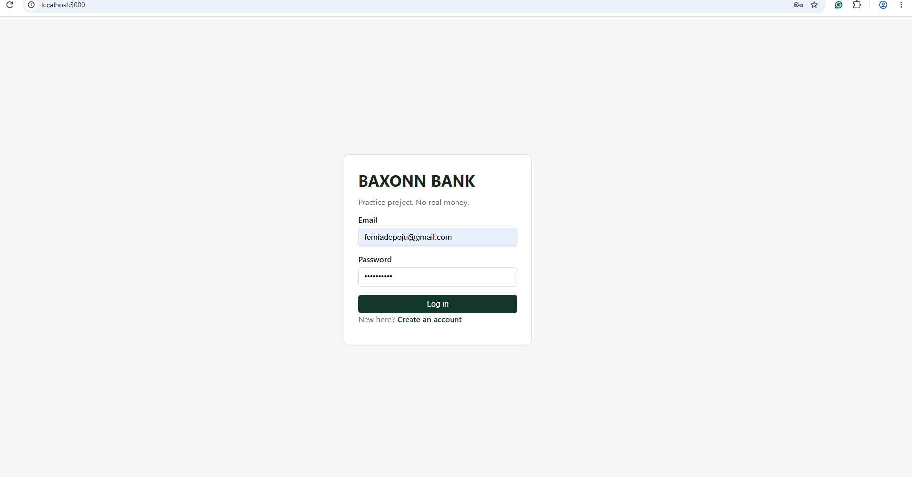
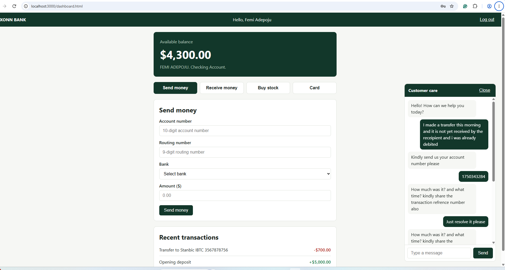

# BAXONN BANK (sample)

A practice banking web app. **Demo only: no real money, no real card or bank data.**

   **Live demo:** https://baxonn-bank-sample.onrender.com (free hosting: may take about a minute to wake up, and data resets periodically)

## Features
- Register and log in (passwords hashed with scrypt, sessions in cookies)
- Activation code required to log in, send money, and unfreeze the card
- Balance, transfers, and stock buying saved in a SQLite database
- Server-side checks: funds, amounts, codes, and stock prices
- Flipping demo card with freeze and unfreeze
- Live customer chat (Socket.IO) with a password-protected staff page at /admin.html

## Tech
HTML, CSS, JavaScript, Node.js, Express, SQLite (node:sqlite), Socket.IO

## Run it locally
1. Install Node.js 22.13 or newer
2. `npm install`
3. `npm start`
4. Open http://localhost:3000. The staff chat password is printed in the terminal.

## Notes
- The activation code is shown on screen for demo purposes. A real bank would send it by SMS or email.
- Data is stored in a local `bank.db` file, created on first run.

## What I learned
 authentication, keeping money logic on the server, real-time chat.

 ## Screenshots

